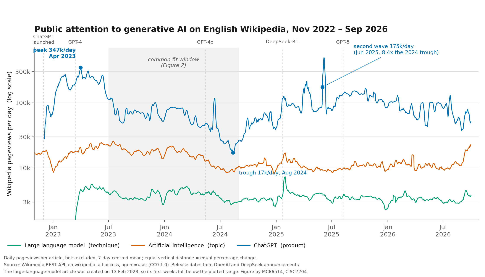
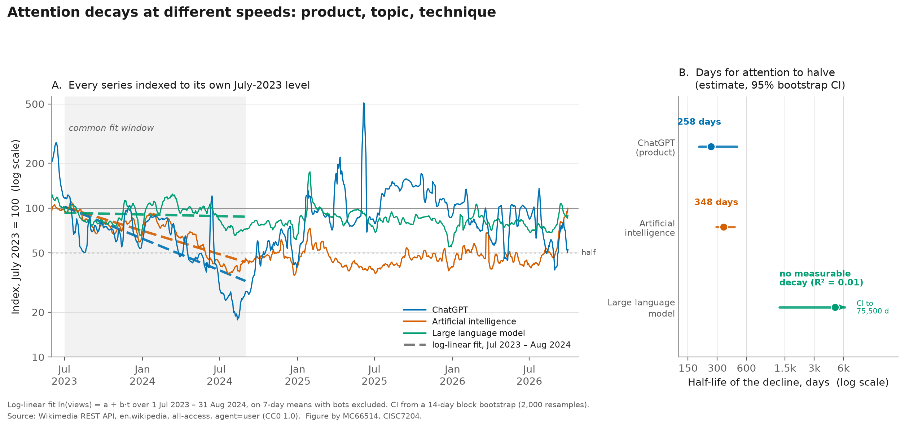

# How Fast Does Public Attention Decay? Evidence from 4,152 Days of Wikipedia Traffic

**Author:** GUO XIAOCHEN (MC66514) · Class G · CISC7204 Analysis of Media and Opinion Data, University of Macau  
**Status:** completed · **Last updated:** 21 October 2026



---

## 1. The problem and the research question

When a technology becomes a public topic, journalists, platforms and policymakers all assume that
attention *spikes and then fades*. But how fast does it actually fade, and does the rate depend on
what kind of page a reader lands on?

This project uses one long, freely available behavioural trace — how many people open a Wikipedia
article each day — to measure the **half-life of public attention** after the generative-AI hype of
2022–23.

**Research question.** After the generative-AI surge peaked, how long did it take for public
attention to halve, and did the decay rate differ between a *product* page (ChatGPT), a *topic*
page (Artificial intelligence) and a *technique* page (Large language model)?

Three sub-questions follow from it:

1. **RQ1 (magnitude).** How large was the wave-1 peak, and how much of it was lost by the trough?
2. **RQ2 (rate).** What is the exponential half-life of the decline, and how uncertain is that number?
3. **RQ3 (persistence).** Did attention come back, and did it come back equally for all three pages?

---

## 2. Dataset source and usage permissions

| Item | Detail |
|---|---|
| Source | Wikimedia REST API, *Pageviews per article* endpoint |
| Endpoint | `https://wikimedia.org/api/rest_v1/metrics/pageviews/per-article/en.wikipedia/all-access/user/{article}/daily/{start}/{end}` |
| Project | `en.wikipedia` (English Wikipedia) |
| Access / agent filter | `all-access` / `agent=user`, i.e. **bots and spiders excluded** |
| Articles | `ChatGPT`, `Artificial_intelligence`, `Large_language_model` |
| Period | 1 Nov 2022 – 30 Sep 2026 (daily granularity) |
| Size | 4,152 article-day observations (1,396 / 1,430 / 1,326 per article) |
| Licence | **CC0 1.0 Universal (public domain dedication)** — Wikimedia pageview data may be reused, redistributed and republished without permission or attribution requirements |
| Permission note | No registration, API key, token or personal login is used. The API is queried anonymously with a descriptive `User-Agent` string, as Wikimedia's API etiquette requests. |
| Personal data | **None.** The data are aggregate daily counters. No individual reader, IP address, cookie or account is observable, so no consent or ethics approval is required. |
| Restricted material | **None.** Nothing in this repository is paywalled, confidential, or covered by a non-disclosure agreement. |

Cached raw payloads are committed under `data/raw/` so that the analysis can be re-run offline and
so that readers can verify that the numbers were not edited by hand. Two articles have shorter
histories because the pages themselves are newer: the `ChatGPT` article was created on
5 Dec 2022 (five days after the product launched) and `Large language model` on 13 Feb 2023.
Their first days therefore fall below the plotted range of Figure 1; this is dataset coverage, not
a filtering choice.

**Citation.** Wikimedia Foundation. (2026). *Pageviews per article* [Data set]. Wikimedia REST API.
https://wikimedia.org/api/rest_v1/

---

## 3. Methods and tools

**Tools.** Python 3.13, `pandas` (reshaping, resampling), `numpy` (least squares),
`matplotlib` (figures), `urllib` (downloading). No proprietary software and no paid data are used.

**Pipeline.** Three scripts, each with one job:

1. `src/fetch_data.py` — calls the API, caches the JSON payloads, and writes the tidy long table
   `data/processed/pageviews_daily.csv` (columns: `date, article_key, article_label, project, views`).
2. `src/analyze.py` — smoothing, peak/trough detection, log-linear fits, bootstrap, and the
   machine-readable output `outputs/results.json` plus `outputs/summary_table.md`.
3. `src/make_figures.py` — reads `results.json`, so every number printed on a chart is the number
   the analysis produced, not a hand-typed label.

**Method, step by step.**

1. **Smoothing.** A 7-day centred rolling mean removes the day-of-week rhythm (weekend traffic is
   systematically lower). No other smoothing is applied, so genuine bursts survive.
2. **Descriptive extremes.** For each article, the wave-1 peak is the maximum of the smoothed series
   within 2023, and the wave-1 trough is the minimum in the following 18 months.
3. **Decay model.** Over one **common window, 1 Jul 2023 – 31 Aug 2024**, I fit by ordinary least
   squares

   `ln(views_t) = a + b · t`,  `t` = days since the window start.

   If `b < 0` the decline is exponential with a constant decay rate, and the time for attention to
   halve is `half-life = ln 2 / (−b)` days. A common window is used deliberately: each article peaks
   on a different date, and the 2025 re-acceleration would otherwise enter some fits and not others,
   which would make the three half-lives incomparable.
4. **Uncertainty.** Daily series are strongly autocorrelated, so an i.i.d. standard error would be far
   too optimistic. I use a **block bootstrap**: 2,000 resamples of contiguous 14-day blocks, refitting
   the slope each time, and report the 2.5th–97.5th percentiles of the resulting half-lives.
5. **Persistence.** For each article I compare its highest monthly mean in 2025 with its lowest
   monthly mean in 2024 (a rebound ratio), and measure **attention churn** as the standard deviation
   of month-on-month log changes from July 2023 onwards — a scale-free measure that is not distorted
   by the fact that the three articles differ in traffic by two orders of magnitude.

**Design choices in the figures.** Both charts use a log y-axis, because on a linear axis the two
smaller articles would collapse into the baseline and disappear; on a log axis equal vertical
distance means equal percentage change, which is exactly what the research question measures, and
a constant decay rate becomes a straight line. There is no dual y-axis anywhere: all three series
share one axis and one unit, so no correlation can be manufactured by the chart form. Every figure
states its unit, its scale, its window and its source.

**Reproducibility details.** The random seed for the bootstrap is fixed (`20261021`), so re-running
the pipeline reproduces the intervals exactly. `python src/fetch_data.py` reuses `data/raw/*.json`
unless `--refresh` is passed, so results do not drift as new pageview days are published.

---

## 4. Key findings



**F1 — The wave-1 peak was enormous and 95% of it disappeared.** The ChatGPT article went from
**347,289 views/day** (7-day mean, 1 Apr 2023) to **17,229 views/day** (12 Aug 2024) — a fall of
**95.0%** in 16 months. Over the same span the topic article *Artificial intelligence* lost
**67.9%** (25,618 → 8,227 views/day) and the technique article *Large language model* lost **54.1%**
(5,603 → 2,572 views/day).

**F2 — Attention halves in roughly eight months, and the estimates are only loosely ordered.**
Over the common window the fitted half-life is **258 days** for ChatGPT (95% CI 195–478, R² = 0.53),
**348 days** for *Artificial intelligence* (95% CI 293–450, R² = 0.73), and effectively
**no measurable decay** for *Large language model* (point estimate 4,920 days, 95% CI
1,311–75,529, R² = 0.01). The point estimates line up in the expected order — product decays
fastest, technique slowest — but the ChatGPT and topic intervals **overlap**, so this dataset
supports "a product page loses attention faster" only as a direction, not as a sharp difference.

**F3 — The decay was not a one-way decline; attention returned, and returned unevenly.** Comparing
the 2025 peak month with the 2024 trough month, the ChatGPT article multiplied by **8.4×**
(20,898 → 174,755 views/day, June 2025), while the topic and technique articles moved only
**1.4×** and **1.5×**. Churn tells the same story: 0.32 (ChatGPT) versus 0.14 (topic) and 0.12
(technique). Public attention behaves like a volatile product cycle, not like a slowly cooling
interest in a subject.

| Metric | ChatGPT | Artificial intelligence | Large language model |
|---|---|---|---|
| Wave-1 peak (7-day mean) | 347,289/day (1 Apr 2023) | 25,618/day (17 Jul 2023) | 5,603/day (8 May 2023) |
| Wave-1 trough | 17,229/day (12 Aug 2024) | 8,227/day (24 Dec 2024) | 2,572/day (28 Dec 2024) |
| Peak → trough | **−95.0%** | −67.9% | −54.1% |
| Half-life, 1 Jul 2023 – 31 Aug 2024 | **258 d** [195, 478] | **348 d** [293, 450] | no decay (R² = 0.01) |
| 2025 peak month vs 2024 trough month | **×8.4** | ×1.4 | ×1.5 |
| Attention churn (SD of monthly log change) | 0.32 | 0.14 | 0.12 |

**Limitation.** Pageviews measure *curiosity*, not opinion: a reader who opens the ChatGPT article
may be a student, a journalist, or someone checking whether the product is down, and nothing in this
dataset records sentiment, agreement or belief. The measure is also single-platform and
single-language (English Wikipedia), so it cannot speak for Chinese-language, social-media or
search attention, which may decay at a different rate. Finally, the analysis is descriptive: the
June-2025 rebound is measured, but this design cannot attribute it to any specific release or news
event, and the overlapping confidence intervals in F2 mean the ordering of the three half-lives
should be read as suggestive rather than established.

---

## 5. Instructions for running the analysis

Requirements: Python 3.10+ and an internet connection for the first run only.

```bash
# 1. get the code and create an isolated environment
git clone https://github.com/Mc66514/data-science-project.git
cd data-science-project
python -m venv .venv

# Windows
.venv\Scripts\activate
# macOS / Linux
source .venv/bin/activate

# 2. install exactly the dependencies used
pip install -r requirements.txt

# 3. run the pipeline, in order
python src/fetch_data.py        # downloads (or reuses) the raw JSON, builds the tidy CSV
python src/analyze.py           # writes outputs/results.json + outputs/summary_table.md
python src/make_figures.py      # writes figures/fig1_*.png and figures/fig2_*.png
```

Expected runtime: under one minute on a laptop, network aside.

**What you should see when it works.**

* `src/fetch_data.py` prints three lines such as
  `downloaded: ChatGPT 1396 days 2022-12-05 -> 2026-09-30` and a total of **4,152 rows**.
* `src/analyze.py` prints the two tables reproduced in Section 4, including the half-lives
  **258 / 348 / 4,920** days.
* `src/make_figures.py` prints the two PNG filenames.

**Useful flags.** `python src/fetch_data.py --refresh` ignores the cache and re-downloads; without
it the committed cache is used, which is what makes an offline re-run possible. The common fit
window, the bootstrap size and the random seed are constants at the top of `src/analyze.py`.

**Repository layout.**

```
data-science-project/
├── data/
│   ├── raw/                    # cached API payloads, one JSON per article
│   └── processed/              # pageviews_daily.csv, pageviews_smoothed.csv
├── figures/                    # the two published PNGs
├── outputs/                    # results.json, summary_table.md
├── src/
│   ├── fetch_data.py
│   ├── analyze.py
│   └── make_figures.py
├── requirements.txt
├── LICENSE
└── README.md
```

**Licence.** Code: MIT (see `LICENSE`). Data: CC0 1.0, as published by the Wikimedia Foundation.
